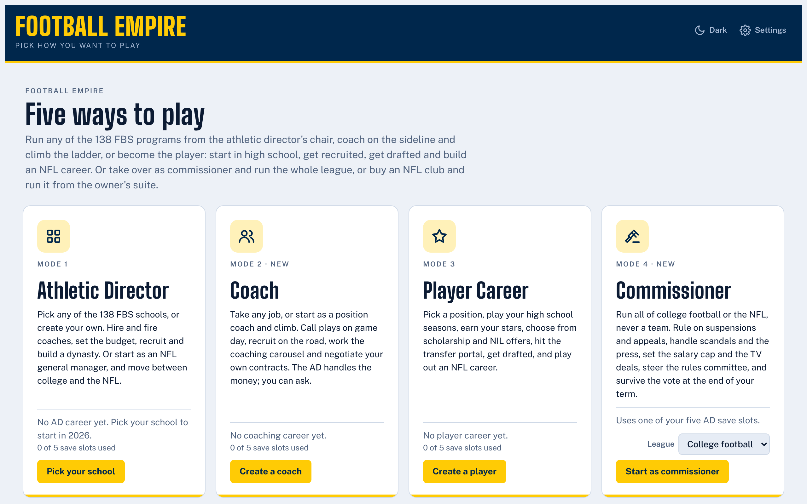
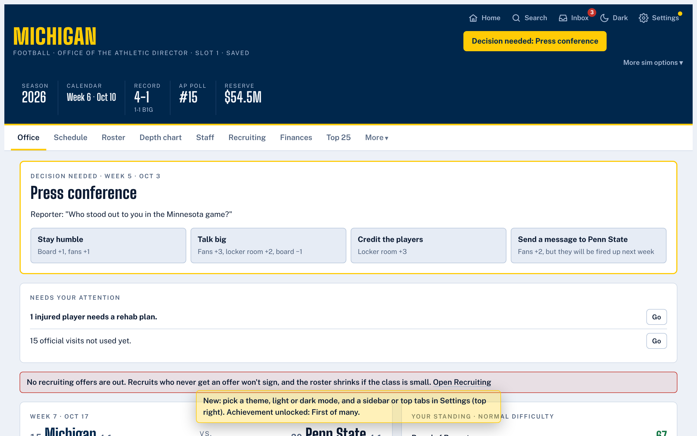
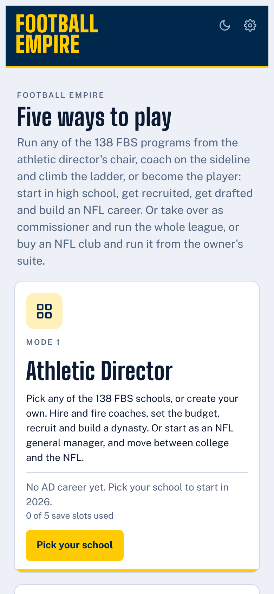

# Football Empire

**A free college football and NFL simulator that runs in your browser. Play it at [collegefbsim.com](https://collegefbsim.com/).**

[](https://github.com/carsonmmm/cfbsim/actions/workflows/ci.yml)

No download, no account, no ads. The whole game is one HTML file, and your careers are saved in your own browser.



## Five ways to play

| Mode | You are | What you do |
|---|---|---|
| **Athletic Director** | The AD at any of the 138 FBS schools, or one you create | Hire and fire coaches, set the budget, recruit, run the department and build a dynasty. You can also start as an NFL general manager and move between college and the NFL. |
| **Coach** | A coach at any level, from position coach to head coach | Call plays on game day, draw your own playbook, recruit on the road, work the coaching carousel and negotiate your own contracts. |
| **Player Career** | One player, from high school on | Earn your stars, choose from scholarship and NIL offers, use the transfer portal, get drafted and play out an NFL career. |
| **Commissioner** | The head of college football or the NFL | Rule on suspensions and appeals, handle scandals, set the salary cap and TV deals, steer the rules committee and survive the vote on your term. |
| **Owner** | The owner of an NFL club | Buy a club or start an expansion team, set prices, build a stadium, hire the GM and coach, and win votes at the owners' meeting. |

Also on the home screen:

- **Daily challenge:** the same school and league for everyone, one season, a new one each day.
- **Scenario challenges:** nine careers that start in trouble (a scandal, an 0-12 program, cap hell, a labor war and more), each with goals and a deadline.
- **Build your own challenge**, and share it with a code.



## What's in the game

- **Game day:** a field view where all 22 players move, with four cameras, weather, live play calling, game plans, halftime adjustments and a two-minute drill.
- **A living world:** a fan feed, a weekly pregame show, a front page, rivalry trophies, award night, record books, a Hall of Fame and league history that carries from one career to the next.
- **Front office depth:** recruiting with uncertain scouting, promises, the transfer portal, the NFL draft, the salary cap, free agency, trades, agents and one negotiation system shared by every mode.
- **Made for long saves:** five save slots per mode, save files you can download, a save health center, and old saves that keep loading after every update.
- **Yours to shape:** five themes, light and dark, a sidebar or top tabs, keyboard shortcuts, color-blind friendly colors, team packs with your own names and colors, and a tutorial for every mode.
- **Works on a phone:** the layout fits a 390px screen.



All 59 updates are in [PATCH_NOTES.md](PATCH_NOTES.md). The current version is **9.52**.

## Good to know

- **Your saves live in your browser.** Clearing site data for collegefbsim.com deletes them. Download a save file from the Save file tab to back one up or move it to another device.
- **Some online features don't work on collegefbsim.com yet.** The daily challenge leaderboard, cloud saves and the friends league were built for a different host. Everything else works. Fixing this is the first item on the [roadmap](ROADMAP.md).

## Where it's going

[ROADMAP.md](ROADMAP.md) has the plan: what to fix first, what to improve in each mode, and what new modes and features are worth building.

## Working on the game

`index.html` is built from `source/`. Don't edit it by hand.

```bash
./build.sh
```

```bash
npm install && npx playwright install chromium
```

```bash
npm test
```

`npm test` confirms that `index.html` matches `source/`, that every mode opens without errors, and that saves load. GitHub runs it on every push. [docs/DEVELOPMENT.md](docs/DEVELOPMENT.md) explains how the code is organized, how to add a feature and the house rules (old saves keep loading, every update gets a patch note, check the phone layout).

Publishing is automatic: GitHub Pages serves the `main` branch at collegefbsim.com, so whatever `index.html` is on `main` is the live game.

## Disclaimer

Football Empire is an unofficial fan project. It is not affiliated with, endorsed by or sponsored by the NCAA, the NFL, any conference, any university or any professional club. Team and school names are used only to identify them. Stadiums, capacities and colors are approximations, and all ratings, salaries, budgets and results are simulated.
